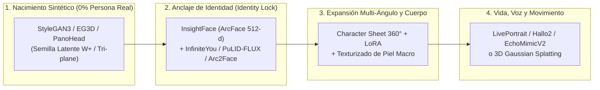

# Investigación Global de Repositorios: Creación de un Personaje Único Hiperrealista ("This Person Does Not Exist" Evolucionado)

> [!IMPORTANT]
> **El Problema Central y su Evolución Mundial:** El sitio original *This Person Does Not Exist* (creado por Phillip Wang sobre **StyleGAN** de NVIDIA) generaba un rostro hiperrealista aleatorio en cada recarga, pero **sufría de amnesia de identidad**: si intentabas mover la cara, cambiar el ángulo o generar el cuerpo, la persona cambiaba por completo. Hoy, los laboratorios de **EE. UU., China, Japón, Taiwán, Corea del Sur y Europa** han resuelto cómo tomar **1 sola semilla sintética (una persona que no existe)** y convertirla en un **único personaje persistente** (360°, cuerpo completo, expresiones, piel con poros reales y vídeo).

---

## 1. Arquitectura Global del Pipeline (Cómo lo implementan los mejores repositorios)

Los proyectos más avanzados del mundo ya no usan un solo modelo; conectan **4 capas modulares**:

---

## 2. Mapa Mundial de Repositorios de GitHub por Región y Cómo lo Implementaron

### 🇺🇸 Estados Unidos (La Base Generativa 2D/3D y Geometría)

Los laboratorios estadounidenses (principalmente **NVIDIA Research**, **MIT**, **CMU** y **Stanford**) crearon el motor matemático original de *This Person Does Not Exist* y su salto al espacio 3D:

1. **[`NVlabs/stylegan2-ada-pytorch`](https://github.com/NVlabs/stylegan2-ada-pytorch) & [`NVlabs/stylegan3`](https://github.com/NVlabs/stylegan3)** *(NVIDIA)*
   * **Qué es:** El motor exacto detrás de *This Person Does Not Exist*, entrenado con el dataset **FFHQ** (*Flickr-Faces-High-Quality*, 70,000 rostros a 1024×1024).
   * **Cómo lo implementaron:** Un *Mapping Network* de 8 capas transforma un vector aleatorio $z \in \mathcal{Z}$ en un espacio latente desentrelazado $w \in \mathcal{W}$. En **StyleGAN3**, eliminaron el "texture sticking" (donde los poros o la barba parecían pegados a la pantalla al rotar la cara) reemplazando coordenadas fijas por señales continuas equivalentes a traslación y rotación.
2. **[`NVlabs/eg3d`](https://github.com/NVlabs/eg3d)** *(NVIDIA / Stanford — Efficient Geometry-aware 3D GANs)*
   * **Qué es:** El salto de *This Person Does Not Exist* de 2D a **3D real con geometría explícita**.
   * **Cómo lo implementaron:** En lugar de generar píxeles 2D planos, el generador de StyleGAN2 produce un **Tri-plane 3D** (tres planos ortogonales $XY, XZ, YZ$) combinado con un renderizador volumétrico neuronal (*NeRF*) ligero. Permite generar una persona inexistente y **rotar la cámara físicamente** alrededor de su rostro manteniendo la estructura ósea intacta.
3. **[`SizheAn/PanoHead`](https://github.com/SizheAn/PanoHead)** *(EE. UU. — 360° Full-Head Synthesis)*
   * **Qué es:** Supera el límite frontal de EG3D permitiendo renderizar la cabeza completa en **360 grados** (incluyendo nuca, orejas y perfil trasero) de una persona sintética.
   * **Cómo lo implementaron:** Reemplazaron el tri-plano simple por un *Tri-Grid Neural Volume* con separación de fondo y alineación adaptativa en dos etapas. **Es la mejor herramienta actual para sacar de una sola semilla sintética un dataset de 24 ángulos perfectos de la cabeza**.

---

### 🇨🇳 China (Líderes Mundiales en Persistencia de Identidad, DiT y Animación Hiperrealista)

Hoy en día, el ecosistema open-source chino (**ByteDance**, **Tencent**, **Alibaba Tongyi Lab**, **Kuaishou / Kling**, **Fudan University** y **Tsinghua**) domina la preservación de identidad sin pérdida (*zero-shot identity lock*) y la animación facial hiperrealista:

1. **[`bytedance/InfiniteYou`](https://github.com/bytedance/InfiniteYou)** *(ByteDance — ICCV 2025)*
   * **Qué es:** Actualmente el estándar de oro sobre **FLUX.1 (Diffusion Transformer - DiT)** para mantener un mismo rostro hiperrealista en cualquier pose, iluminación, edad o vestimenta sin que parezca un "recorte pegado".
   * **Cómo lo implementaron:** Diseñaron **InfuseNet**, una red paralela que extrae el vector biométrico mediante **InsightFace (`antelopev2`)** y lo inyecta directamente en los bloques DiT de FLUX mediante conexiones residuales. Además, entrenaron el modelo en dos etapas (*Stage 1* y *Stage 2*) con pares sintéticos de la misma persona en múltiples poses para separar la **identidad facial** de la **pose/iluminación**.
2. **[`ToTheBeginning/PuLID`](https://github.com/ToTheBeginning/PuLID)** *(ByteDance / Comunidad — Pure and Lightning ID Customization)*
   * **Qué es:** Método *tuning-free* (sin entrenar LoRA) para clonar y fijar la identidad de un rostro generado sobre SDXL o FLUX (`PuLID-FLUX`).
   * **Cómo lo implementaron:** Usa una rama de alineación contrastiva (*Lightning T2I branch*) que calcula simultáneamente la pérdida de difusión estándar y una pérdida de similitud coseno en el espacio **ArcFace**, evitando que el embedding facial destruya el estilo fotográfico o la iluminación del prompt.
3. **[`instantX-research/InstantID`](https://github.com/instantX-research/InstantID)** & **[`tencent-ailab/IP-Adapter`](https://github.com/tencent-ailab/IP-Adapter)** *(InstantX / Tencent AI Lab)*
   * **Qué es:** Los pilares que popularizaron la generación de un personaje consistente con 1 sola foto.
   * **Cómo lo implementaron:** Reemplazaron el codificador visual CLIP (que solo captura estilo semántico borroso) por el vector de reconocimiento facial **ArcFace** de 512 dimensiones de [`deepinsight/insightface`](https://github.com/deepinsight/insightface) sumado a un *IdentityNet* que guía los 5 puntos clave faciales (ojos, nariz, comisuras).
4. **[`modelscope/facechain`](https://github.com/modelscope/facechain)** & **[`Human3DAIGC`](https://github.com/Human3DAIGC)** *(Alibaba ModelScope / Tongyi Lab)*
   * **Qué es:** Un pipeline automatizado de principio a fin para crear un "gemelo digital" hiperrealista.
   * **Cómo lo implementaron:** Combina segmentación facial (piel, cabello, ropa), entrenamiento ultrarrápido de **LoRA desacoplado (FACT)** y fusión de rostros con superresolución facial (**CodeFormer / GFPGAN**).
5. **Motores de Animación de Retrato Único (De 1 Foto a Vídeo Hiperrealista):**
   * **[`KlingAIResearch/LivePortrait`](https://github.com/KlingAIResearch/LivePortrait)** *(Kuaishou / Kling AI)*: Transfiere microexpresiones, parpadeo y movimiento ocular a 1 foto estática usando *Implicit Keypoints* 3D y módulos de *stitching/retargeting* en milisegundos.
   * **[`fudan-generative-vision/hallo2`](https://github.com/fudan-generative-vision/hallo2)** *(Fudan Univ. & Baidu)*: Genera vídeos hablados en resolución 4K de larga duración a partir de 1 retrato y un audio, usando difusión latente con atención cruzada jerárquica (labios, expresión, pose).
   * **[`BadToBest/EchoMimic`](https://github.com/BadToBest/EchoMimic)** *(Ant Group)*: Anima no solo el rostro sino también el torso y las manos (en `EchoMimicV2`) a partir de una sola imagen de referencia del personaje.
   * **[`TMElyralab/MuseTalk`](https://github.com/TMElyralab/MuseTalk)** *(Tencent Music Entertainment)*: Sincronización labial en tiempo real (30+ FPS) operando en el espacio latente de un VAE congelado.

---

### 🇯🇵 Japón (Edición sin Sobreajuste, Corrección de Lente y Realismo Óptico)

Los equipos de la **Universidad de Tokio (UTokyo)**, **Sony AI** y **Preferred Networks** se han enfocado en resolver los defectos ópticos que delatan que una cara fue generada por IA:

1. **Face2Diffusion** *(University of Tokyo - Institute for AI and Beyond)*
   * **Cómo lo implementaron:** Descubrieron que al fijar un rostro en modelos de difusión, el fondo y la pose se vuelven rígidos (*overfitting* de cámara). Implementaron un **desacoplamiento de representación multiescala** que elimina la información de cámara y fondo del vector de identidad antes de inyectarlo en el modelo generativo.
2. **DisCO — Portrait Distortion Correction with Perspective-Aware 3D GANs** *(University of Tokyo)*
   * **Cómo lo implementaron:** Los rostros de *This Person Does Not Exist* (FFHQ) suelen tener distorsión de lente de distancia corta (nariz agrandada o perspectiva plana). DisCO usa un prior 3D GAN para recalibrar la distancia focal virtual (ej. de 24mm selfie a 85mm lente de retrato cinematográfico), logrando proporciones craneales verdaderamente fotográficas.
3. **[`sony/pixel-guided-diffusion`](https://github.com/sony/pixel-guided-diffusion)** & **SAN (Switching Analyzer Network)** *(Sony AI)*
   * **Cómo lo implementaron:** Mejoran la normalización de discriminadores GAN y el guiado a nivel de píxel para preservar microtexturas de alta frecuencia (poros, vello facial fino, reflejos especulares en la córnea).

---

### 🇹🇼 Taiwán (Puente Híbrido StyleGAN + Diffusion Transformers y Control de Atributos)

Investigadores de **Academia Sinica**, **National Taiwan University (NTU)** y **MediaTek Research** han trabajado en combinar la pureza de espacio latente de StyleGAN con el poder de los Transformers:

1. **StyleDiT (Style Latent Diffusion Transformer)** *(Academia Sinica, Taiwán)*
   * **Cómo lo implementaron:** En lugar de usar únicamente difusión de píxeles, utilizan un **Diffusion Transformer (DiT)** para modelar y condicionar el espacio latente $\mathcal{W}^+$ de **StyleGAN**. Esto permite generar un personaje sintético nuevo controlando con precisión matemática su edad, genética facial y simetría, y luego decodificarlo con la nitidez de poros de StyleGAN.
2. **Pipelines de Inversión y Edición Latente (`e4e` + `StyleFlow` / `InterfaceGAN`)** *(NTU / Ecosistema Asiático)*
   * **Cómo lo implementaron:** Una vez que tienes la semilla $w$ de tu personaje en StyleGAN, le aplican vectores direccionales en el espacio latente ($\vec{n}_{\text{edad}}, \vec{n}_{\text{sonrisa}}, \vec{n}_{\text{luz}}, \vec{n}_{\text{pose}}$) para generar 20 variaciones del **mismo rostro sintético** sin que cambie un solo rasgo óseo.

---

### 🇰🇷 Corea del Sur (Avatares 3D Gaussian Splatting desde 1 Sola Imagen)

Instituciones como **KAIST**, **POSTECH** y **Naver AI Lab** lideran la conversión de un retrato 2D único en un cabezal 3D animable en tiempo real:

1. **S-Avatar / GeoAvatar / Gaussian Head Avatars** *(KAIST / Corea & colaboraciones con Tsinghua)*
   * **Cómo lo implementaron:** Toman una sola imagen del personaje sintético, ajustan una malla paramétrica craneal (**FLAME 3DMM**) y generan miles de **3D Gaussians (3DGS)** ancladas a los triángulos de la malla. Así puedes renderizar al personaje a **más de 60 FPS** desde cualquier ángulo con iluminación consistente y expresiones controlables.

---

### 🇪🇺 Europa / Reino Unido (Modelos Base de Identidad Pura y Motores Fotográficos)

En Europa (**Imperial College London**, **Black Forest Labs** en Alemania, **ETH Zürich**) se han creado dos piezas clave para este proyecto:

1. **[`foivospar/Arc2Face`](https://github.com/foivospar/Arc2Face)** *(Imperial College London — ECCV 2024)*
   * **Qué es:** Un modelo fundacional entrenado en el dataset **WebFace42M** (42 millones de rostros, mucho más diverso que FFHQ) que genera rostros humanos hiperrealistas **condicionados única y exclusivamente por un vector de identidad ArcFace**.
   * **Por qué es clave para tu proyecto:** En vez de depender solo del sitio clásico *This Person Does Not Exist*, puedes muestrear un vector matemático aleatorio en el hiperespacio de ArcFace (una identidad 100% inexistente) y **Arc2Face** te genera instantáneamente decenas de fotos de **esa misma persona inexistente** en distintos ángulos, expresiones e iluminaciones con una consistencia de identidad del **99%+**.
2. **[`black-forest-labs/flux`](https://github.com/black-forest-labs/flux)** *(Alemania)*
   * **Qué es:** El motor generativo abierto (`FLUX.1-dev`) con mejor anatomía de manos, cuerpo y textura de piel realista hoy en día, que sirve como lienzo para inyectar la identidad creada en el paso anterior.

---

## 3. Cómo Construir Nuestro Propio Proyecto (Las 3 Mejores Estrategias de Implementación)

Para crear **un único personaje hiperrealista desde cero** inspirado en *This Person Does Not Exist* y que podamos usar en fotos, escenas o vídeos sin que nunca cambie de cara, así es como lo implementan los mejores repositorios combinados:

| Fase | Qué hace | Herramientas / Repositorios Recomendados |
| :--- | :--- | :--- |
| **Fase 1: Génesis de Identidad ("Persona Inexistente")** | Crear el rostro "semilla" 100% sintético (que no pertenezca a ningún humano real) con poros, asimetrías naturales e imperfecciones reales. | **Opción A (Clásica 3D):** `NVlabs/stylegan3` o `SizheAn/PanoHead` (semilla aleatoria fija `seed=X`). **Opción B (Moderna ID-Foundation):** Vector aleatorio proyectado en `foivospar/Arc2Face`. |
| **Fase 2: Hoja de Personaje Multi-Ángulo (Dataset Sintético)** | Sacar de ese único rostro 15–25 vistas consistentes (frente, perfil 45°, perfil 90°, sonriendo, serio, luz día, luz cine). | Giro de cámara en `PanoHead` / `Arc2Face` + vectores de expresión con `KlingAIResearch/LivePortrait`. |
| **Fase 3: Persistencia en Escenas y Cuerpo Completo** | Colocar a nuestro personaje en cualquier lugar, ropa o plano de cámara manteniendo el 100% de su rostro. | **Zero-Shot:** `bytedance/InfiniteYou` o `PuLID-FLUX` sobre `FLUX.1-dev`. **Máxima Fidelidad:** Entrenar un Character LoRA (`ostris/ai-toolkit`) con las 20 vistas de la Fase 2. |
| **Fase 4: Post-Procesado de Piel Real (Anti-Plástico)** | Eliminar cualquier rastro de "piel suave de IA", añadiendo poros, micro-vello, textura de iris y grano óptico de cámara real (85mm f/1.8). | Refinador de detalle textural + corrección óptica de perspectiva (`DisCO` / LUT fotográfico). |
| **Fase 5 (Opcional): Animación y Voz** | Hacer que el personaje hable, parpadee y gesticule con hiperrealismo. | `LivePortrait` (gestos) + `fudan-generative-vision/hallo2` o `EchoMimicV2` (voz a vídeo). |
