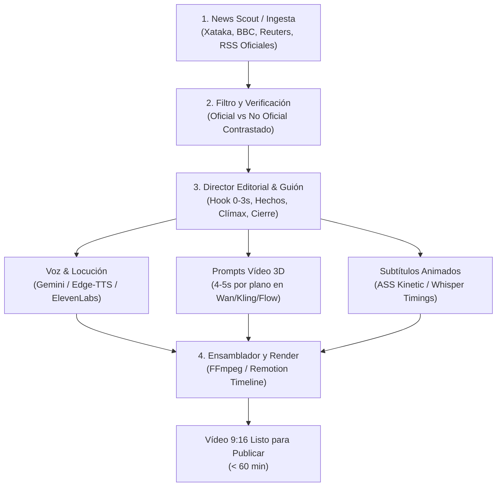

# TikTok Radar · Arquitectura del Noticiero 3D Automatizado

Sistema de producción automatizada de vídeos verticales de alto impacto (formato *News Explainer* con animación 3D estilizada y locución periodística profesional), diseñado para publicar en **menos de 60 minutos** desde la confirmación de la noticia.

---

## 1. Visión y Propuesta de Valor Comercial

* **El Problema del Espectador:** La gente quiere enterarse de las noticias más impactantes al instante, pero los noticieros tradicionales son lentos y aburridos, y los canales de IA típicos usan fotos estáticas mediocres o humanos sintéticos de «valle inquietante» que dan rechazo.
* **Nuestra Solución:** Un noticiero vertical dinámico con **recreaciones en animación 3D estilizada** (tipo *Arcane* / simuladores cinemáticos), locutor profesional de tono documental y rigurosidad periodística (separando fuentes oficiales de reportes preliminares).
* **Escalabilidad:** Un pipeline automatizable que genera el paquete completo (investigación, guion, locución, clips de 4-5s y subtítulos kinetic) en menos de 1 hora.

---

## 2. Anatomía del Pipeline en 4 Capas

### Capa 1: Ingesta y Monitoreo de Fuentes (News Scout)
* **Fuentes Oficiales:** Comunicados de la FAA / NTSB (aviación), boletines de ministerios/gobiernos, reportes de empresas matrices, declaraciones judiciales.
* **Fuentes de Prensa Especializada y Foros Reconocidos:** Xataka (tecnología/ciencia), BBC Mundo, Reuters, El País, TechCrunch, Hacker News.
* **Separación Editorial Obligatoria:** Si un dato no está confirmado por una autoridad oficial, la narración debe declararlo explícitamente (*«según reportes preliminares de medios locales...»*).

### Capa 2: Director Editorial y Redacción Estructurada (61–65 s Monetizables)
* **Regla de Pacing para Monetización (>60 s):** 61 a 65 segundos totales (130 a 145 palabras).
* **Bloques narrativos para sostener la retención durante todo el minuto:**
  1. *Gancho (0–3 s):* Suspenso o interrogante disruptivo inmediato.
  2. *Contexto Oficial (3–14 s):* Datos verificados, modelo de aeronave / dispositivo y lugar del suceso.
  3. *Recreación Dramática - Acto 1 (14–26 s):* El momento en que inician las alarmas y la reacción en cabina/escena.
  4. *Recreación Dramática - Acto 2 (26–40 s):* El descenso crítico, la maniobra física y el último reporte de telemetría.
  5. *Investigación Técnica (40–52 s):* Lo que revelan las cajas negras, datos de radar y declaraciones de las autoridades.
  6. *Conclusión e Interacción (52–63 s):* Hipótesis en disputa y pregunta directa al espectador para detonar comentarios.

### Capa 3: Generación de Activos
1. **Vídeo (4 a 5 segundos por plano):**
   - Planos cortos de 4-5 s en herramientas de generación (Wan 2.1, Kling 1.5, Google Flow, Minimax).
   - **Por qué NO 10 segundos:** Menor tiempo de procesamiento en colas de GPU, cero deformaciones anatómicas/morfeo y adaptación perfecta al ritmo de edición vertical (cortes cada 2,5-3,5 s).
   - Dos modalidades automáticas:
     * *Modo Recreación:* Personajes animados 3D con gesticulación expresiva (sudor, tensión, luces de emergencia).
     * *Modo Infográfico:* Animaciones 3D de hardware, mapas topográficos, interfaces HUD y documentos holográficos.
2. **Locución (Voz de Locutor):**
   - Timbre maduro, entonación periodística de ritmo firme, sin pausas robóticas.
   - Pistas de audio normalizadas a `-14.8 LUFS` con música instrumental continua en segundo plano y *ducking* automático (-6 dB bajo la voz).
3. **Subtítulos Kinetic (Rebote y Resaltado):**
   - Generación de subtítulos nativos sincronizados palabra por palabra con colores contrastados (amarillo/cian sobre blanco y reborde oscuro).

### Capa 4: Ensamblaje y Renderizado
* Motor de compilación automatizado vía FFmpeg / Remotion en Python.
* Escalado nativo a 1080×1920 a 24/30 fps.
* Verificación técnica automatizada (`DECODE_OK`, control de clipping True Peak < -0.5 dBTP).

---

## 3. Benchmarking de Proyectos Open-Source (GitHub Insights)

Tras analizar repositorios líderes como `tsensei/OpenReels`, `ezedinff/TikTok-Forge`, `indiser/ViralContent-Factory` y `MoneyPrinterTurbo`:

| Truco / Técnica de la Industria | Cómo lo aplicamos en TikTok Radar |
| :--- | :--- |
| **Separación de Hooks:** Probar 2 ganchos por noticia | El script genera Gancho A (misterio) y Gancho B (dato numérico impactante). |
| **Whisper Word-Level Alignment** | Alineación de cada palabra al milisegundo para subtítulos dinámicos de alta retención. |
| **Ken Burns 3D Interpolation** | En planos infográficos o estáticos, aplicar paneo y zoom subpíxel para evitar planos muertos. |
| **Cache de Activos de Transición** | Biblioteca fija de SFX de impacto (risers, swooshes periodísticos, alarmas) para ensamblaje en segundos. |

---

## 4. Hoja de Ruta Comercial

1. **Fase 1 (Inmediata):** Validación del formato con la primera noticia prototipo (ejemplo del accidente aéreo en Florida).
2. **Fase 2:** Script maestro en `TIKTOK_RADAR/tools/` que tome el enlace de una noticia de Xataka o BBC y produzca el storyboard completo en 60 segundos.
3. **Fase 3:** Integración con APIs de generación directa o plantilla lista para pegado asistido en Google Flow / Kling.
