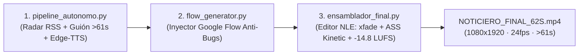

# MANUAL DE SUPERVISIÓN Y OPERACIÓN AUTÓNOMA EN SERVIDOR AWS (`TIKTOK-NEWS`)

Este documento rige y supervisa todo el flujo de producción dentro del servidor AWS (`ubuntu@3.142.230.147` · directorio `~/TIKTOK-NEWS`). Está diseñado tanto para que tú ejecutes el sistema con un solo comando como para que **cualquier agente de IA que abras directamente dentro del servidor AWS** conozca al 100% la arquitectura, los selectores de Google Flow, las reglas de auto-curación y los controles de calidad.

---

## 1. Arquitectura de 3 Fases del Pipeline Autónomo

Todo el flujo reside en `tools/` y se ejecuta en cadena mediante `tools/ejecutar_todo.py`:



| Script | Función Exacta | Salida |
| :--- | :--- | :--- |
| [`tools/news_radar.py`](tools/news_radar.py) | Escanea en vivo RSS de **Xataka**, **BBC Mundo** y **El País Tecnología**, separando fuentes oficiales y prensa. | Lista JSON de noticias en memoria. |
| [`tools/pipeline_autonomo.py`](tools/pipeline_autonomo.py) | Puntúa impacto, redacta guión de **61–65 s** (monetizable en TikTok), crea 13 prompts 3D (`prompt` + `fallback_prompt` anti-bloqueo) y sintetiza voz con `edge-tts` (`es-MX-JorgeNeural`). | `entregas/<fecha>_AUTONOMO/metadata.json`, `LOCUCION_NOTICIERO_62S.mp3`, `PAQUETE_NOTICIERO_LISTO.md` |
| [`tools/flow_generator.py`](tools/flow_generator.py) | Abre Chrome headless con perfil `~/flow-profile`, limpia locks huérfanos, inyecta los 13 prompts en Google Flow, auto-aprueba confirmaciones, esquiva bloqueos de políticas con `fallback_prompt` y descarga `SH01.mp4`..`SH13.mp4`. | `entregas/<fecha>_AUTONOMO/shots/SH01.mp4` a `SH13.mp4` |
| [`tools/ensamblador_final.py`](tools/ensamblador_final.py) | Editor de vídeo algorítmico NLE sobre FFmpeg Filtergraph: aplica cámara dinámica (Ken Burns + vibración en cabina), transiciones `xfade`, subtítulos `.ass` Kinetic palabra por palabra y masterización de audio multicapa a **`-14.8 LUFS`**. | `entregas/<fecha>_AUTONOMO/NOTICIERO_FINAL_62S.mp4` |
| [`tools/ejecutar_todo.py`](tools/ejecutar_todo.py) | Orquestador maestro que ejecuta las 3 fases de principio a fin. | Vídeo final listo para publicar. |

---

## 2. Comandos Rápidos en el Servidor AWS

### A. Actualizar el servidor con los últimos cambios del algoritmo
Cada vez que afinemos el algoritmo y hagamos push a GitHub, en tu servidor AWS solo ejecuta:
```bash
cd ~/TIKTOK-NEWS
git pull origin main
```

### B. Ejecutar la Fábrica Completa (Noticias + Flow + Edición NLE Final)
Para producir el vídeo completo del día de forma 100% desatendida:
```bash
cd ~/TIKTOK-NEWS
python3 tools/ejecutar_todo.py
```

### C. Ejecutar en Segundo Plano (sin que se corte si cierras la terminal SSH)
Si quieres lanzarlo y apagar tu laptop mientras el servidor AWS genera los 13 planos en Flow y edita el vídeo:
```bash
cd ~/TIKTOK-NEWS
nohup python3 tools/ejecutar_todo.py > ~/produccion_radar.log 2>&1 &
```
Para ver en vivo por qué plano va desde cualquier terminal:
```bash
tail -f ~/produccion_radar.log
```

### D. Ejecutar Fase por Fase (Supervisión Granular)
1. **Solo generar noticia, guión y locución (>61 s):**
   ```bash
   python3 tools/pipeline_autonomo.py
   ```
2. **Solo generar/reanudar los vídeos en Google Flow (con Checkpointing):**
   *(Si ya existen `SH01.mp4`..`SH05.mp4`, los salta y continúa automáticamente desde `SH06.mp4`)*
   ```bash
   python3 tools/flow_generator.py
   ```
3. **Solo ensamblar el vídeo final con efectos, transiciones y subtítulos Kinetic:**
   ```bash
   python3 tools/ensamblador_final.py
   ```

---

## 3. Protocolo de Supervisión y Auto-Curación (Para el Agente en AWS)

Si ejecutas el agente directamente dentro del servidor AWS (`~/TIKTOK-NEWS`), el agente debe verificar y aplicar estas reglas automáticamente:

1. **Verificación de Sesión de Google Flow (`~/flow-profile`):**
   - Antes de lanzar un lote largo, si hay duda del estado de login, ejecutar `python3 tools/test_flow_session.py`.
   - Si Chrome se cerró abruptamente antes, `flow_generator.py` elimina automáticamente `SingletonLock`, `SingletonCookie` y `SingletonSocket` dentro de `~/flow-profile`.
2. **Resiliencia ante Bugs de Google Flow:**
   - **Popups intrusivos:** El inyector envía `Escape` 3 veces y cierra modales antes de tocar la caja de texto.
   - **Confirmación del Agente de Flow:** Si Flow muestra el radio/botón `Aprobar` (`Approve`), `flow_generator.py` lo pulsa automáticamente.
   - **Bloqueos de políticas (`infringir`, `Error`, `policy`):** Si el prompt principal de un plano dramático es rechazado por filtros de palabras sensibles, el inyector recarga la página y reintenta automáticamente con el `fallback_prompt` (100% descriptivo y visual en 3D estilizado).
   - **Doble vía de descarga:** Intenta primero el menú nativo (`Más opciones` -> `Descargar` -> `720p`/`1080p`) y, si la UI falla, descarga directamente el stream `.mp4` interceptado desde la red de Google Flow.
3. **Auditoría Técnica del Máster Final (`NOTICIERO_FINAL_62S.mp4`):**
   - **Duración obligatoria:** `>= 61.0 segundos` (para activar monetización en *TikTok Creator Rewards Program*).
   - **Formato de vídeo:** `1080x1920` (9:16 vertical), `24 fps`, `H.264 High Profile`, `yuv420p`, `DECODE_OK`.
   - **Sonoridad masterizada:** `-14.8 LUFS` (±0.5 LU) con voz clara en primer plano, cama de suspenso continua y efectos *whoosh* en cada transición `xfade`.
